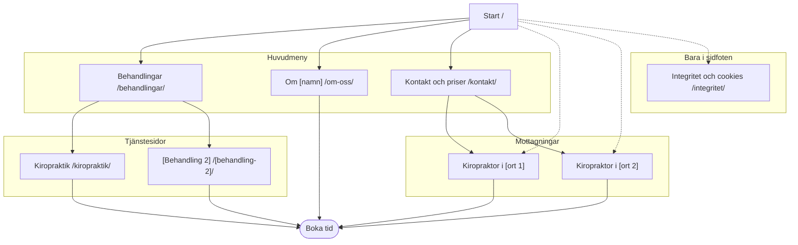

# Sidkartan

Sidkartan är en tabell i `sites/<namn>/sidkarta.md`, inte en del av briefen, med adress, besökarens fråga, söksträngar och primär handling per sida (→ `guide/2-3-struktur.md`, N1). Från sajt 2 får den två kolumner till – innehållskälla i faktabasen och handlingen som för mot nordstjärnan (N2) – och vid fler nivåer än standardsajten ett Mermaid-diagram (N2). Johnny ser sidkartan med briefen; kunden ser strukturen i riktningarna.

Formaten nedan är destillerade ur marketingskills `site-architecture` ([SKILL.md](https://github.com/coreyhaines31/marketingskills/blob/main/skills/site-architecture/SKILL.md), MIT, v2.1.0, och `references/mermaid-templates.md`), som har fem utdata: träd, Mermaid, adresstabell, navigationsspec och internlänkplan. Tabellen är sanningen; de andra formaten härleds ur den och får inte säga emot den. Rättas sidkartan rättas den i samma varv som beslutet som ändrar sajten (`BESLUT.md` 2026-10-16, G7).

## Exempel: en kiropraktor med mottagningar i två städer

### Tabellen

| Sida | Adress | Besökarens fråga | Söksträngar | Primär handling |
|---|---|---|---|---|
| Start | `/` | Kan jag få hjälp här, var, när och vad kostar det? | kiropraktor [ort 1], kiropraktor [ort 2] | Boka tid; ring |
| Behandlingar | `/behandlingar/` | Vad kan ni hjälpa mig med? | kiropraktor [besvär] | Vidare till rätt behandling |
| Kiropraktik | `/kiropraktik/` | Hur går det till och vad kostar det? | kiropraktor ryggskott | Boka tid |
| [Behandling 2] | `/[behandling-2]/` | … | … | Boka tid |
| Kiropraktor i [ort 1] | `/kiropraktor-[ort-1]/` | Var tar ni emot i [ort 1], när och hur hittar jag dit? | kiropraktor [ort 1] | Boka tid i [ort 1] |
| Kiropraktor i [ort 2] | `/kiropraktor-[ort-2]/` | … | kiropraktor [ort 2] | Boka tid i [ort 2] |
| Om [namn] | `/om-oss/` | Vem är du, och kan jag lita på dig? | – | Boka tid |
| Kontakt och priser | `/kontakt/` | Hur når jag er, och vad kostar det? | kiropraktor pris | Boka tid; ring |
| Integritet och cookies | `/integritet/` | Vad händer med mina uppgifter? | – | – |
| 404 | – | Var hamnade jag? | – | Till start; boka tid |

Vid ombyggnad behålls fungerande adresser från den gamla sajten när de redan följer reglerna, även om de inte ligger under `/tjanster/`; varje gammal adress får en ny adress eller ett beslut om att sidan tas bort (→ `guide/2-2-omfattning.md`). Översiktssidan kan då ligga på första nivån med tjänstesidorna bredvid sig.

### Trädet

```
/                         Start
├── /behandlingar/        Behandlingar (översikt, i menyn)
│   ├── /kiropraktik/
│   └── /[behandling-2]/
├── /kiropraktor-[ort-1]/ Mottagningen i [ort 1]
├── /kiropraktor-[ort-2]/ Mottagningen i [ort 2]
├── /om-oss/              Om [namn] (i menyn)
├── /kontakt/             Kontakt och priser (i menyn)
└── /integritet/          Integritet och cookies (sidfoten)
```

Trädet visar den typiska vägen, och den är vad brödsmulorna visar – inte adressens kataloger ([navigation.md](navigation.md), *Brödsmulor*).

### Mermaid

Prövad med mermaid 11.4.1 (renderas utan fel, 10 noder, 2026-10-16). GitHub ritar `mermaid`-block i Markdown direkt.



Heldragna pilar är menyns och översikternas länkar, streckade pilar kontextuella länkar. Den primära handlingen är slutnoden, så att det syns att varje sida leder dit. Över ungefär 15 noder blir diagrammet svårläst; dela det då per zon.

### Navigationsspec

| Zon | Innehåll i ordning | Not |
|---|---|---|
| Sidhuvud, dator | Namn · Behandlingar · Om [namn] · Kontakt och priser · telefon · Boka tid | Sidans primära handling ersätter Boka där den skiljer sig (G5) |
| Sidhuvud, mobil | Namn · Meny | Kontaktvägen i knapplisten nere (`BESLUT.md` 2026-10-15) |
| Menypanelen | Start · varje behandling · Om · Kontakt och priser · Boka · Ring | Samma namn som sidorna (G4) |
| Sidfot | Mottagningar med adress som kartlänk · kontakt · sidorna · företagsuppgifter · Integritet och cookies | → `guide/2-3-struktur.md`, N1 |
| Brödsmulor | Normalt inga: sajten har högst två nivåer (NN/g) – förslag till Johnny om guidens brödsmulor på tjänstesidorna | [navigation.md](navigation.md) |

### Internlänkplan

| Sida | Länkar ut i texten till | Får länkar in från |
|---|---|---|
| Start | varje behandling, varje mottagning, Om | menyn, sidfoten, alla sidor via namnet |
| Behandling | närliggande behandlingar, mottagningarna, Om (vid behandlarens namn) | översikten, start, mottagningarna |
| Mottagning | den andra mottagningen, behandlingarna, Kontakt | start, Kontakt, behandlingarna |
| Om | behandlingarna personen utför, mottagningarna | start, behandlingarna |
| Kontakt | mottagningarna | menyn, sidfoten, behandlingarna |

Ingen siffra för antal länkar per sida: Google kräver bara att varje viktig sida har en länk från minst en annan sida och att länktexten beskriver målet (📄 [Link best practices](https://developers.google.com/search/docs/crawling-indexing/links-crawlable)).
